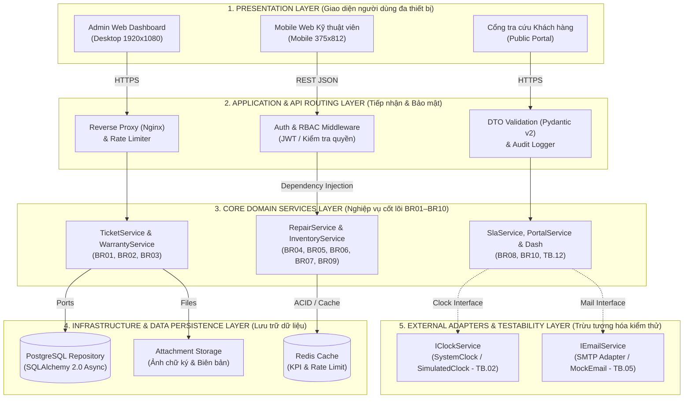
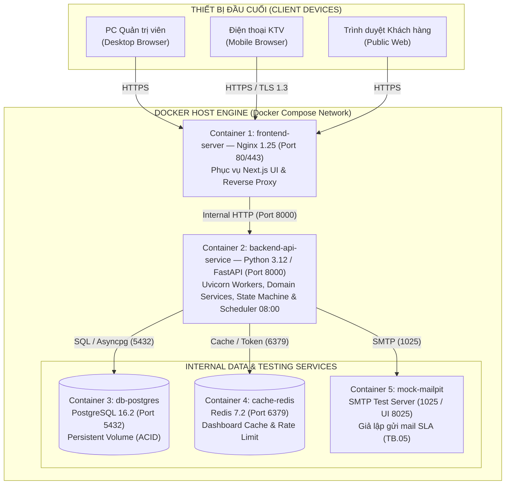
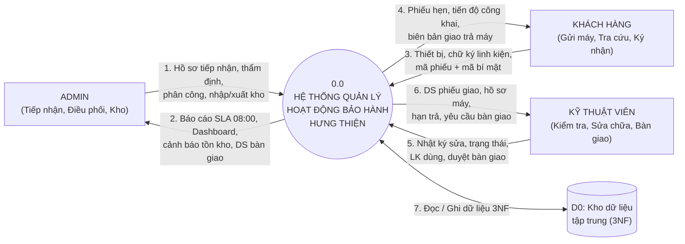
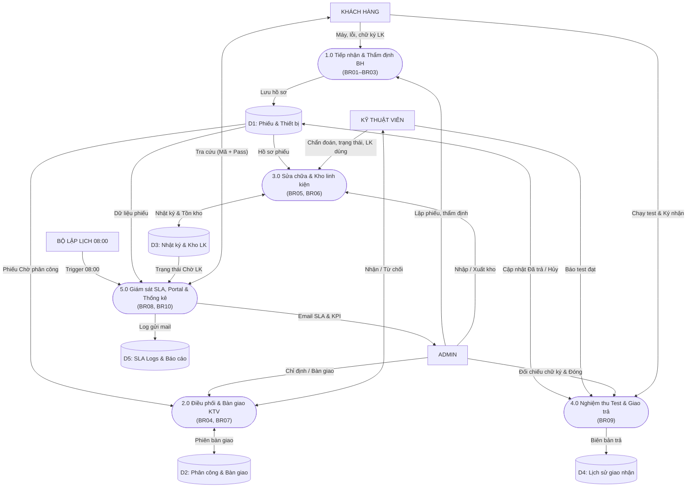
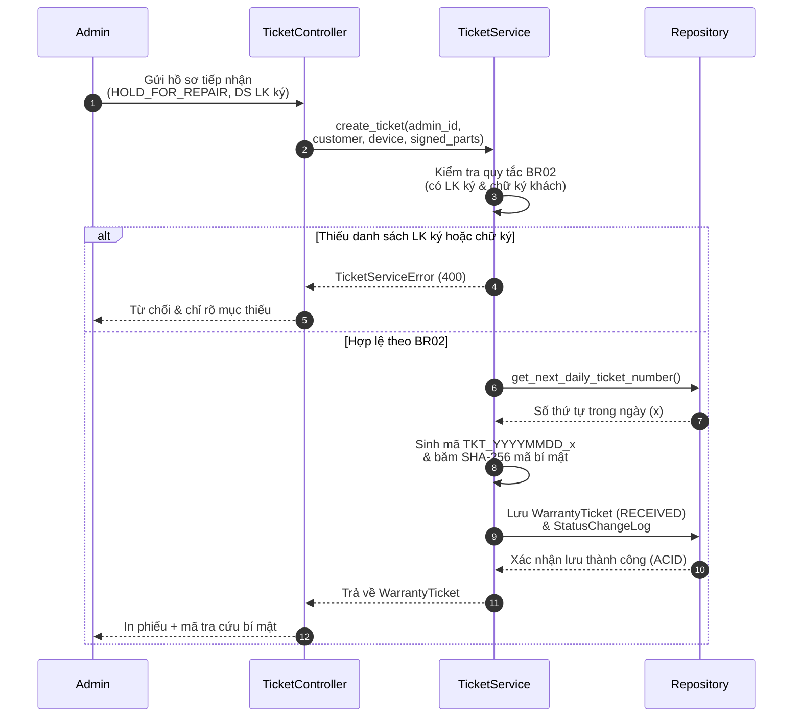
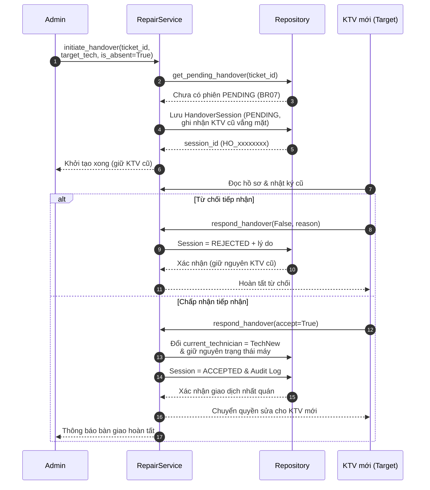
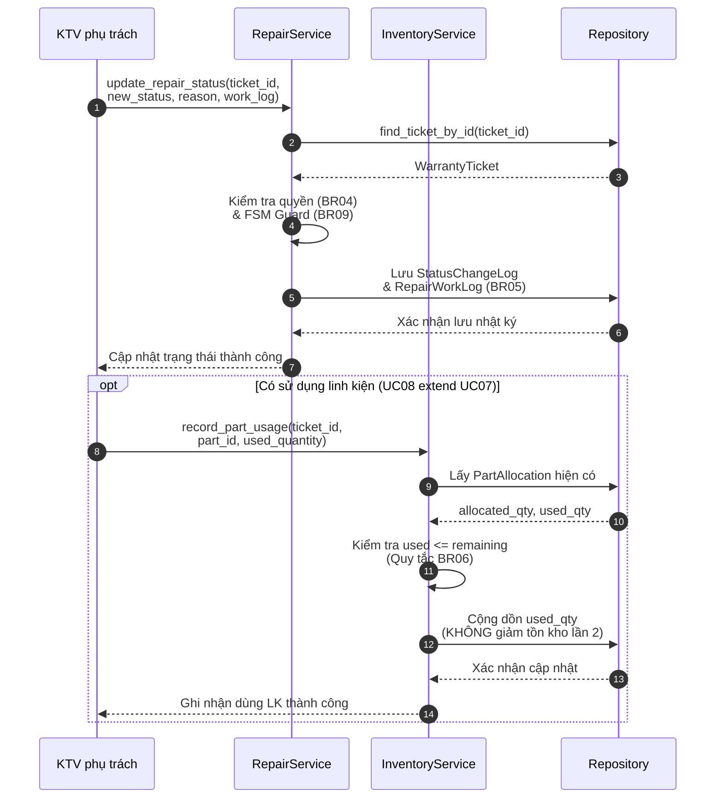
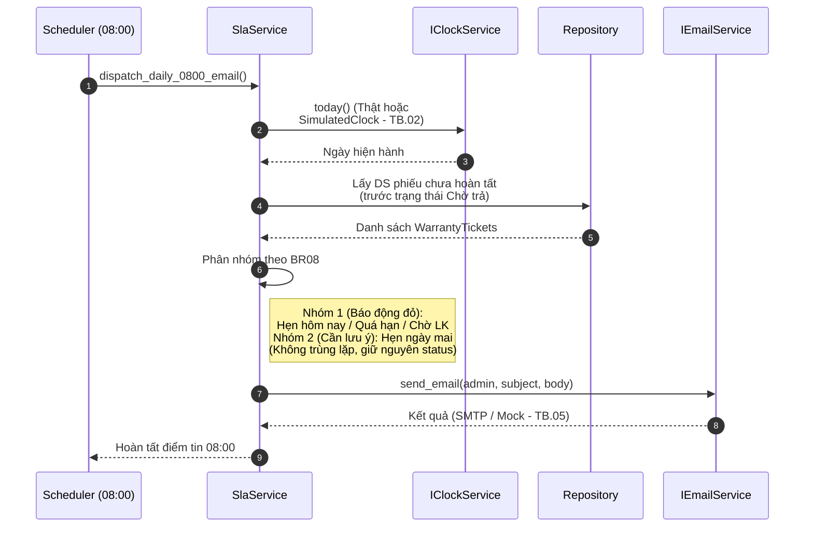

# Bộ mã Mermaid cho các sơ đồ Chương 4 (PSE.G102)

Bạn có thể dán trực tiếp các đoạn mã dưới đây vào:
- **Mermaid Live Editor:** https://mermaid.live (chỉnh sửa và tải ảnh PNG/SVG độ phân giải cao)
- **Draw.io (diagrams.net):** Menu *Arrange -> Insert -> Advanced -> Mermaid*
- **Notion / GitHub Markdown / Obsidian**

---

## Hình 4.1: Sơ đồ khối kiến trúc phân tầng logic Clean Layered Architecture

---

## Hình 4.2: Sơ đồ triển khai hạ tầng Container hóa với Docker Compose

---

## Hình 4.3: Sơ đồ luồng dữ liệu ngữ cảnh (Context DFD Cấp 0)

---

## Hình 4.4: Sơ đồ luồng dữ liệu DFD Cấp 1 phân rã tiến trình hệ thống

---

### Hình 4.5: Biểu đồ tuần tự luồng tiếp nhận thiết bị giữ máy và ký linh kiện (UC03 – BR02)

---

## Hình 4.6: Biểu đồ tuần tự quy trình bàn giao điều chuyển KTV khi KTV cũ vắng mặt (UC06 – BR07)

---

## Hình 4.7: Biểu đồ tuần tự cập nhật tiến độ sửa chữa và ghi nhận sử dụng linh kiện kho (UC07, UC08 – BR05, BR06)

---

## Hình 4.8: Biểu đồ tuần tự bộ máy tự động gửi điểm tin SLA lúc 08:00 (SLA – BR08)

